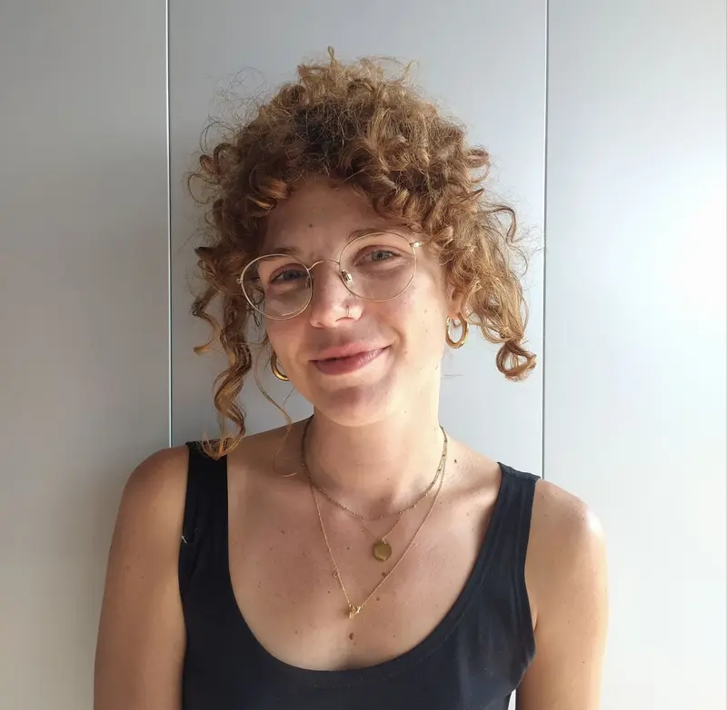

##  Keynotes

### Beatrice Savoldi (she/her)
*Fondazione Bruno Kessler*

#### Gender, Users, and Inclusive Multilingual Language Technologies

**Abstract**

As language technologies increasingly permeate society and mediate how people communicate, questions of gender bias reach a broader and more diverse set of users and scenarios. What shapes the usability of these technologies and their potential for harm in real-world settings? How do these issues emerge differently across languages, cultures, and marginalized communities? And how are they reconfigured in frontier, natively multimodal models?

Machine translation (MT), among the most extensively studied and user-facing tasks in NLP, has long been at the forefront of gender bias research, during a period marked by societal, linguistic, and technological shifts. Using MT and multilinguality as a litmus test for bias research, I will reflect on the evolution and directions of the field, bringing together work that centers users, pairs inclusive design with sociolinguistic innovations, and extends beyond text to speech technologies.

---

### Vagrant Gautam (they/them)
*Heidelberg Institute for Theoretical Studies*

#### Measurement and impact in bias research

**Abstract**

After nearly a decade of bias research, I argue we still do not have consensus on how to measure bias, and how our work impacts NLP systems deployed in the real world. In this talk, I will provide an overview of some of these issues, such as defining gender and bias, and operationalizing them via imperfect proxies. I will then revisit older debates such as intrinsic versus extrinsic bias, as well as newer debates like natural versus synthetic data, studying open or closed models, and measuring the impact of our work. I will close with some of my own suggestions for where bias research in NLP should go next, but hope to encourage discussion afterwards with the community on how we can address these problems going forward.
